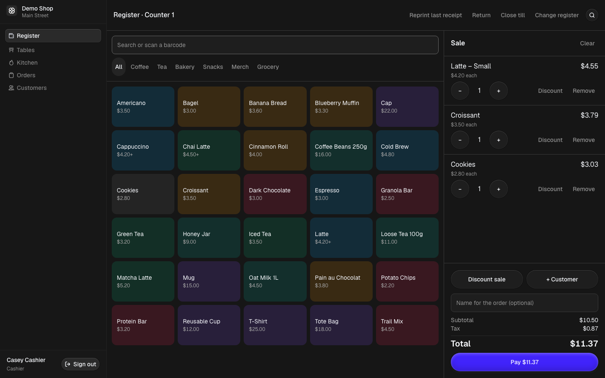
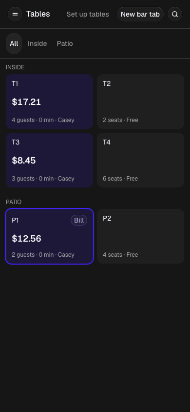
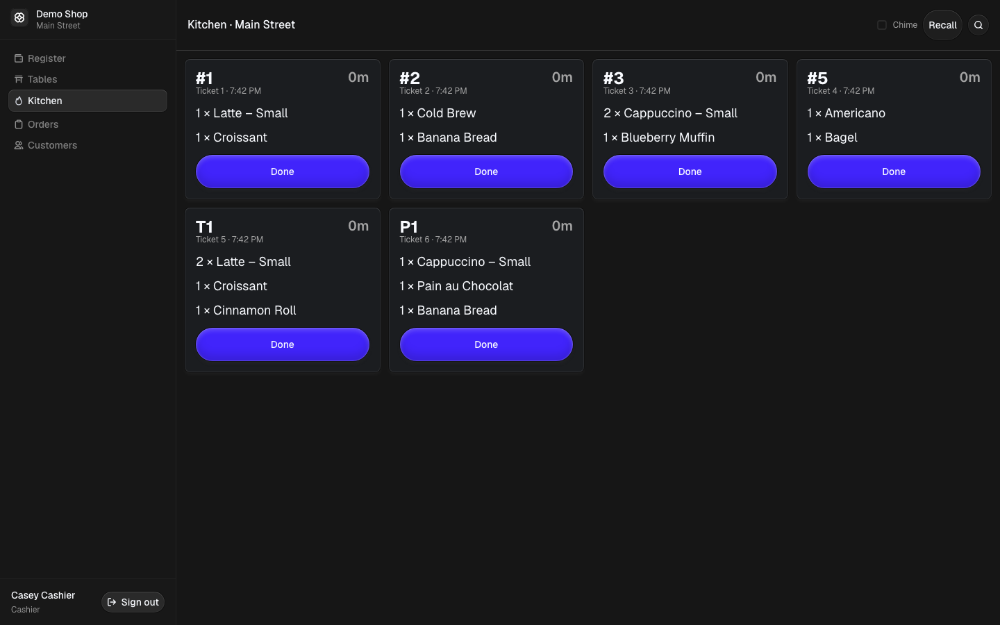
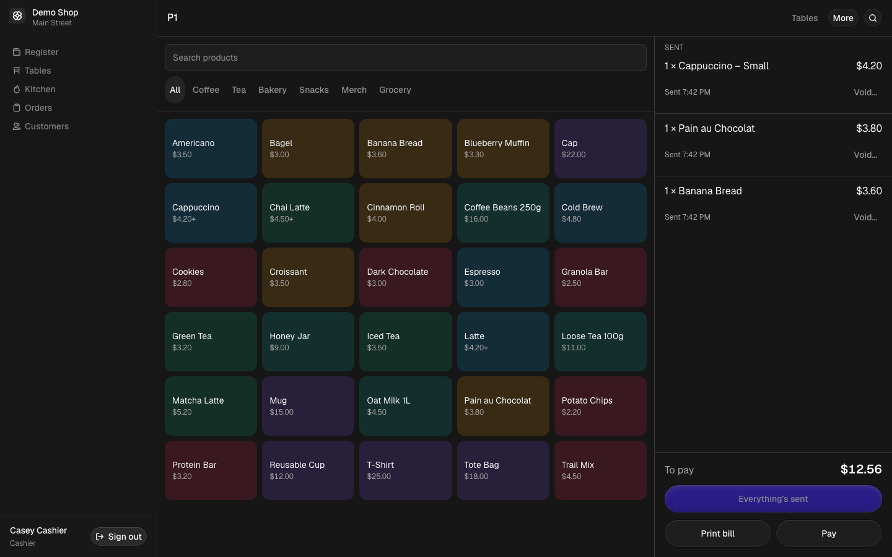
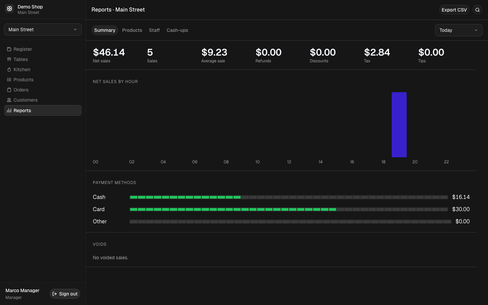

# POS

[](https://github.com/JohnCarl-30/pos/actions/workflows/ci.yml)
[](LICENSE)

A free, open-source point of sale for shops, cafés and restaurants. Self-host it with your own Supabase database: your sales data stays yours.



## What it does

- **Register:** fast touch till with search and barcode scanning, discounts with manager approval, cash, card and split payments, tips, and 80mm receipts from any printer.
- **Products and stock:** variants, modifiers ("oat milk +$0.50"), stock history per store, low-stock alerts, and CSV import and export.
- **Restaurants and bars:** tables by area, open tabs from servers' phones, a live kitchen screen, and bills split by item, evenly, or by any amount.
- **Orders and customers:** searchable sales, refunds item by item, voids, and customer history.
- **Reports:** sales, best sellers, staff and cash-ups per store, with CSV export.
- **Several stores, one business,** with owner, manager and cashier roles enforced in the database.

| Tables on a phone | Kitchen screen |
| --- | --- |
|  |  |

| A tab | Reports |
| --- | --- |
|  |  |

Card payments are recorded, not charged: use your existing card terminal. The app needs an internet connection; there's no offline mode yet.

Want to help? Read [CONTRIBUTING.md](CONTRIBUTING.md). Found a security problem? See [SECURITY.md](SECURITY.md).

## Quick start

You need Node 20.9 or newer, Docker Desktop, and npm.

```bash
npm install
npm run db:start      # starts Supabase locally in Docker
npm run env:local     # writes .env.local from the local stack
npm run dev
```

Open http://localhost:3000 and sign in with a demo account (password `password`):

| Email | Role |
| --- | --- |
| owner@demo.test | Owner — everything, every store |
| manager@demo.test | Manager — products, stock, refunds, reports |
| cashier@demo.test | Cashier — sell, orders, customers |
| inactive@demo.test | Deactivated — shows the no-access message |

To try the first-run setup instead, run `npx supabase db reset --no-seed` and open the app in a private window.

## Catalog & stock

- **Products** (managers and owners): add products with named variants, each with its own SKU, barcode, price and cost. Archive instead of deleting, so past sales stay intact.
- **Stock** is kept per store as a history: received, counted, damaged, corrected or transferred. Counts always match the history. Set a low-stock level per item to use the "Low stock" filter.
- **CSV import/export:** export, edit in a spreadsheet, import back. Imports are matched by SKU, previewed before anything is saved, and applied all-or-nothing. Comma or semicolon files both work.
- **One currency for now:** prices are shared by every store, so all stores should use the same currency until multi-currency support arrives.

## Register

- **Tills:** each device picks its register and opens the till with the starting cash. Closing the till compares counted cash with what the sales say should be there.
- **Selling:** tap products, search, or scan a barcode (any USB scanner that types works). Discount a line or the whole sale by % or amount. Cashiers can discount up to the store's limit (20% by default, set in Settings → Stores); bigger discounts need a manager or owner to approve on the till.
- **Payments:** cash with change, card, other, or any split of them. Card payments are recorded, not charged — use your existing card terminal.
- **Receipts:** printed from the browser at 80mm width, so any receipt printer your device can print to works. Reprint the last receipt from the register.
- **Totals are always calculated by the database** from current prices, so they can't be changed from the browser.

## Orders, refunds & customers

- **Orders:** every sale in the store, searchable by receipt number or customer and filterable by date, status, register and cashier. Each sale shows its lines, payments, discounts and refunds, and can reprint its receipt.
- **Refunds:** give back some or all of a sale, item by item. Items can go back into stock or be marked damaged. Money goes back by the original method (card first, then cash), and cash refunds come out of the open till's expected cash. Cashiers need a manager or owner to approve each refund on the till. Start a refund from the sale's page or with **Return** on the register.
- **Voids:** cancel a sale while its till is still open, for mistakes caught straight away. Cashiers can void their own sales. After the till closes, use a refund instead.
- **Sales can't be edited:** nobody, not even the owner, can change or delete a recorded sale directly. Every correction is a refund or a void, with who did it and who approved it.
- **Customers:** a list with total spent and last visit, and a page per customer with their sales and refunds. Customers with sales can't be deleted.

## Reports

Managers and owners get reports for the store picked in the sidebar, for today, yesterday, the last 7 or 30 days, this or last month, or any range up to a year. Days and hours follow the store's time zone.

- **Summary:** net sales, number of sales, average sale, refunds, discounts and tax. It also shows a sales chart by hour or day, a cash/card/other split, and voided sales.
- **Products:** best sellers by net revenue or units, with refunds taken off, and each category's share.
- **Staff:** sales, refunds, voids and discounts per person. Voids above 3%, refunds above 5% of sales, and any voided cash sale are flagged.
- **Cash-ups:** every closed till, with its float, cash sales, cash refunds, expected and counted cash, and whether it was short or over.
- **CSV export** of whichever report you're looking at.

Refunds count on the day they happen, and voided sales never count, so a day's report matches its tills and doesn't change later.

## Cafés & counters

- **Modifiers:** set up groups like "Milk (pick 1): whole, oat +$0.50" or "Extras (up to 3)" under Products → Modifiers, then tick them on each product. The register asks for required choices, shows the price as you go, and prices everything in the database.
- **Tips:** add No tip, 10%, 15%, 20% or a custom amount when taking payment. Tips are never taxed, discounted or counted as sales. Cash tips count in the drawer, and reports show tips separately.
- **Kitchen tickets:** tick "Kitchen" on categories that the kitchen makes. After a sale, **Print kitchen ticket** prints an 80mm ticket with the order number, an optional name and each item's choices, without prices. Turn on **Auto-print kitchen tickets** to print one after every kitchen sale on that device. For no print dialog at all, run the browser in kiosk printing mode (for example Chrome's `--kiosk-printing`).

## Restaurants & bars

- **Tables:** managers add areas (Inside, Patio) and tables under **Tables → Set up tables**. Servers see a grid of tables on their phone: free, open with the running total and time seated, or waiting with the bill printed.
- **Tabs:** tap a table, enter the guests, and add items. Notes like "no onions" go to the kitchen. **Send** sends everything new as one ticket; sent items are locked, and taking one off needs a void with a reason, which the kitchen sees. Bar tabs work the same with a name instead of a table.
- **Kitchen screen:** open **Kitchen** on a tablet. Tickets from tabs and from counter sales with kitchen items appear live, oldest first, with a timer that turns amber at 10 minutes and red at 20. **Done** clears a ticket; **Recall** brings back the last one.
- **Paying:** **Pay** opens the till with the tab's items. Pay everything, pick items for each guest, or use **Split evenly** in the payment step. Each payment is an ordinary sale with its own receipt, so refunds, reports and the cash drawer work as before.

## Scripts

| Script | What it does |
| --- | --- |
| `npm run dev` | Start the app |
| `npm run lint` | Lint the code with ESLint |
| `npm test` | Unit tests (money, tax, checkout and tab maths, validation) |
| `npm run test:db` | Database tests: schema, access rules and every sale function (pgTAP) |
| `npm run test:e2e` | End-to-end tests (resets the local database; run `npx playwright install chromium` once first) |
| `npm run db:reset` | Rebuild the local database with demo data |
| `npm run db:types` | Regenerate TypeScript types from the schema |

## Deploying

1. Create a Supabase project. Run `npx supabase link --project-ref <ref>` then `npx supabase db push` (this does not load demo data).
2. In Supabase Auth settings, turn off "Allow new users to sign up". Staff accounts are created from Settings, never by public sign-up.
3. Deploy the Next.js app anywhere that runs Node (Vercel works out of the box). Set `NEXT_PUBLIC_SUPABASE_URL`, `NEXT_PUBLIC_SUPABASE_PUBLISHABLE_KEY` and `SUPABASE_SERVICE_ROLE_KEY`.
4. Open the site. You'll be taken to setup to create your business, first store and owner account.
5. Optional: under Tables → Set up tables, add areas and tables if you serve at tables. The live floor and kitchen screen use Supabase Realtime, which the migrations already turn on.

> The first person to open a fresh deployment completes setup and becomes owner — finish setup immediately after deploying.

## How it's built

Next.js 16, React 19, Tailwind 4 and Supabase (Postgres, Auth, row-level security, Realtime). Roles are enforced in the database, not just the UI. Money is stored as whole cents, and every price, total and refund is calculated by database functions. See [CONTRIBUTING.md](CONTRIBUTING.md) for how the code is organised; `docs/superpowers/specs/` has the design doc for each feature.

## Notes

- After `npx supabase db reset`, clear the `pos-setup-complete` cookie in your browser (or use a private window). It remembers that setup was already done, so a reset database can otherwise redirect you straight past the setup wizard.
- For production, set the Site URL in your hosted Supabase project's Auth settings, and upload `supabase/templates/recovery.html` as the password-recovery email template. Without both, password reset links won't work.

## License

MIT. The starter UI is © Kargul Studio, also MIT.
